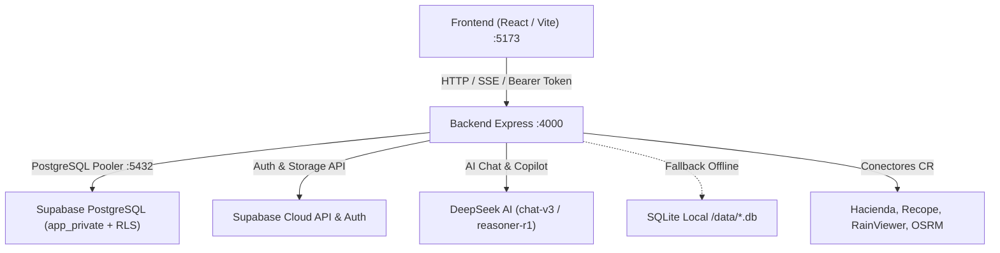

# Sistema de Sinergia Urbana Costa Rica — Fullstack Monorepo

Plataforma urbana inteligente y colaborativa para Costa Rica. Integra un backend Express desacoplado con **Supabase PostgreSQL** (`app_private` con RLS), motor de IA **DeepSeek**, conectores de servicios públicos costarricenses (Hacienda, BCCR, Recope, OSRM, RainViewer) y tolerancia total a desconexión mediante fallback local SQLite.

---

## 🏛️ Arquitectura del Sistema



- **Backend:** Node.js + Express 4 con arquitectura modular por dominios (`backend/src/modules/`).
- **Base de Datos Principal:** **Supabase PostgreSQL 17** (Proyecto `hnnnreowlbtqqjhpmdvd`, esquema privado `app_private` cerrado con Row Level Security).
- **Base de Datos de Respaldo:** SQLite integrado en Node.js (cero configuración para desarrollo offline y pruebas).
- **Inteligencia Artificial:** DeepSeek AI (`deepseek-chat` y `deepseek-reasoner`) para copiloto de voz tico, itinerarios multi-día y resolución de imprevistos.
- **Frontend:** React + Vite (`frontend/src/`) con diseño accesible, soporte PWA y modo sin conexión.

---

## 🚀 Inicio Rápido Local

### 1. Requisitos Previos
- **Node.js** v20+ o v24+
- **NPM** v10+

### 2. Poner en Marcha el Backend
```bash
# 1. Navegar a la carpeta backend
cd backend

# 2. Instalar dependencias
npm install

# 3. Iniciar el servidor (conectará automáticamente a Supabase PostgreSQL)
npm run dev
```

El servidor estará escuchando en `http://localhost:4000/api`.
- Chequeo de salud general: `GET http://localhost:4000/api/health`
- Chequeo de conexión a Supabase: `GET http://localhost:4000/api/health/supabase`
- Chequeo de base de datos relacional: `GET http://localhost:4000/api/health/db`
- Swagger UI interactivo: `http://localhost:4000/api/docs`

### 3. Poner en Marcha el Frontend
```bash
# Desde otra terminal:
cd frontend
npm install   # Si no están instaladas las dependencias
npm run dev
```
La aplicación abrirá en `http://localhost:5173`.

---

## 🧪 Pruebas Automatizadas

El backend cuenta con **38 pruebas automatizadas** con 100% de éxito:

```bash
# Desde la carpeta backend:
npm test

# O desde la raíz del proyecto:
npm run test:backend
```

### Cobertura de las Pruebas:
1. **Transacciones ACID y Rollbacks:** Verificación atómica en creación de planes y paradas.
2. **Seguridad y Criptografía:** Hashing de contraseñas con PBKDF2 (100.000 iteraciones + salt aleatorio) y rotación de Refresh Tokens.
3. **Observabilidad Enterprise:** Inyección distribuida de `x-request-id`, telemetría del sistema y métricas Prometheus (`/api/metrics`).
4. **DeepSeek AI Copilot:** Conversación multi-turn con memoria de sesión, generación de itinerarios multi-día y clasificación de intenciones de voz en lenguaje coloquial costarricense.
5. **Catálogo Geográfico:** Búsqueda radial GPS (Haversine) y paginación con metadatos.
6. **Supabase Cloud:** Diagnóstico de salud, cliente seguro resiliente y almacenamiento.
7. **Concurrencia Optimista:** Prevención de colisiones con HTTP 409 ante propuestas obsoletas.
8. **Resiliencia Offline:** Operación continua sin interrupciones cuando proveedores externos o redes no están disponibles.

---

## 📂 Documentación del Proyecto

| Documento | Audiencia | Descripción |
|---|---|---|
| 📘 [Guía de Integración para el Frontend](docs/frontend-integration-guide.md) | **Desarrollador Frontend** | Guía paso a paso para consumir la API, autenticación Supabase, cliente HTTP reutilizable, sockets SSE y ejemplos de componentes |
| 📑 [Contrato de API y OpenAPI](docs/api-contract.md) | Fullstack / Evaluadores | Especificación técnica de todos los endpoints, formato envolvente `{ ok, data, error }` y códigos de estado |
| 🗺️ [Recorrido de Prueba y Checklist MVP](docs/mvp-checklist.md) | QA / Evaluadores | Pasos secuenciales para verificar el 100% de la funcionalidad del MVP |
| 🌐 [Integraciones Abiertas y Resiliencia](docs/integrations.md) | Arquitectura | Conectores públicos sin costo (Hacienda, Recope, OSRM, RainViewer, etc.) |
| 🗄️ [Scripts y Esquema de Supabase](backend/supabase/README.md) | DevOps / DBA | DDL del esquema `app_private`, políticas RLS y seeds de demostración |
