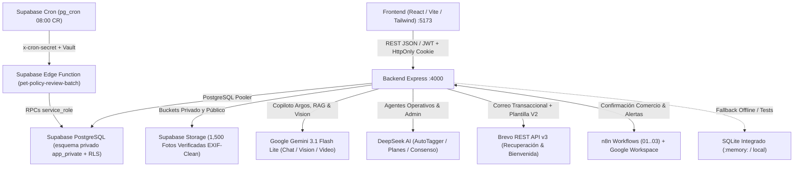

# 🐾 Synodos Pet OS — Plataforma Inteligente Pet-Friendly y Copiloto Urbano para Costa Rica

**Synodos Pet OS** es una plataforma fullstack diseñada para tutores de mascotas, comercios aliados y administración urbana en **Costa Rica** (con foco principal en la **Gran Área Metropolitana — GAM**: San José, Heredia, Alajuela y Cartago, más destinos nacionales).

Integra un backend empresarial en **Node.js + Express**, persistencia en **Supabase PostgreSQL** (`app_private` aislado de la API pública + RLS) con respaldo automático en **SQLite**, catálogo verificado de **681 restaurantes reales y 1,500 fotografías verificadas sin EXIF** en **Supabase Storage**, **Motor RAG Híbrido** para el Copiloto **Argos**, correo transaccional en vivo con **Brevo REST API v3**, inteligencia artificial dual (**Google Gemini 3.1 Flash Lite / Vision** para clientes y **DeepSeek AI** para administración), **Supabase Cron + Edge Function** para revisión automática 24/7 de políticas pet-friendly, **8 Agentes de IA con gobernanza**, flujos opcionales en **n8n** y despliegue unificado mediante **`render.yaml`**.

---

## 🏛️ Arquitectura del Sistema



### Estructura Principal del Proyecto
```text
sn/
├── backend/
│   ├── src/
│   │   ├── modules/           # Dominios: auth, places, rag, admin-control, vet-hub, voice-ai-concierge, notifications...
│   │   ├── autonomous-agents/ # Agentes autónomos (AutoTagger estricto, clima, consenso, frescura)
│   │   ├── controllers/       # Controladores HTTP (triaje visual, hub de 8 agentes)
│   │   ├── models/            # Modelos ORM seguros en 3FN y cifrado de columnas sensibles
│   │   ├── routes/            # Rutas con guardias RBAC, validación y rate limiting
│   │   └── shared/            # Config (DB, Supabase, Gemini, DeepSeek, Brevo), seguridad, auditoría y caché
│   ├── supabase/              # Esquema MVP, semillas, migraciones pg_cron y Edge Function
│   │   ├── functions/pet-policy-review-batch/index.ts
│   │   ├── migrations/20261127_pet_policy_review_cron.sql
│   │   └── schema/
│   └── test/                  # Suite automatizada (156/156 pruebas con node --test)
├── frontend/                  # Aplicación web React + Vite (3 temas visuales, Mapa GAM, Terrazas, Argos, Admin)
├── n8n/workflows/             # Workflows 01..03 conectados con Google Workspace
├── docs/                      # Contratos de API, arquitectura, matriz RBAC y diagramas ER
└── render.yaml                # Blueprint de despliegue unificado (API + SPA) en Render
```

---

## ✨ Módulos Principales

### 1. 🧠 Copiloto Argos + Motor RAG Híbrido (`/api/concierge/*` y `/api/rag/*`)
- **Recuperación Híbrida en Tiempo Real (`rag-service.js`):** Antes de responder, **Argos** combina guías verificadas en `app_private.rag_documents` (emergencias vet 24/7 en CR, Hospital UNA `2277-3600`, alimentos/plantas tóxicas, asfalto caliente GAM, etiqueta pet-friendly, Ley 7600 y Ley 8968) con los **681 restaurantes reales del catálogo**.
- **Estado Pet-Friendly Transparente:** Usa la reconciliación de evidencia de Supabase; cuando un local solo tiene sugerencias externas o una política vencida, indica explícitamente `«admisión por confirmar»` sin inventar políticas ni nombres de locales.
- **Importación Segura desde Google Drive (`POST /api/rag/import/gdrive`):** Permite a administradores sincronizar Google Docs públicos al índice RAG con validación estricta **Anti-SSRF**.

### 2. 🐾 Revisión Automática de Políticas Pet-Friendly 24/7 (`Supabase Cron` + `Edge Function`)
- **Programación en la Nube sin Servidores Extra:** El job `synodos_pet_policy_daily_review` (`pg_cron` + `pg_net`, 08:00 hora Costa Rica) invoca la Edge Function `pet-policy-review-batch` autenticada con secreto en **Supabase Vault** (`x-cron-secret` en tiempo constante).
- **Lote Diario con Rotación y Protección de Cuota:** Procesa un lote configurable (por defecto `10` locales/día) priorizando políticas vencidas, próximas a vencer y sin confirmar, con corte inmediato ante `HTTP 429` (`stopped_due_to_quota: true`) y presupuesto de tiempo sin activar facturación.
- **Solo Sugerencias + Verificación de Sucursal:** Comprueba sucursal por ID de proveedor o nombre + dirección/zona, aplica las reglas estrictas del etiquetador (descarta falsos positivos y registra rechazos explícitos), guarda hallazgos únicamente como sugerencias en `place_pet_evidence` (sin sobrescribir confirmaciones vigentes) y envía sugerencias o contradicciones a la bandeja administrativa (`GET /api/admin/pet-automation/review-queue`).

### 3. 🩺 Pre-Triaje Visual de Mascotas con Google Gemini Vision (`/api/pets/analyze-photo`)
- Evalúa de **1 a 3 fotografías** eliminando metadatos **EXIF/GPS (`APP1`)** por privacidad (Ley N.º 8968) antes de consultar `gemini-3.1-flash-lite` (con fallback a `gemini-3-flash-preview` y motor heurístico local).
- Cubre **10 áreas clínicas**, semáforo de urgencia (`leve`, `moderado`, `urgente`), temperatura estimada del asfalto en la GAM, clínicas veterinarias 24/7 cercanas con enlaces a **Waze / Google Maps** y seguimiento evolutivo (`/follow-up`).

### 4. 🗺️ Catálogo Verificado de 681 Restaurantes y 1,500 Fotografías Reales
- **Resolución DB-First (`supabase_database`):** 1,500 fotografías reales auditadas, deduplicadas por SHA-256, limpias de EXIF y con atribución/licencia verificada en `gotox-place-photos-public` (~265 MB), servidas con caché en memoria + `ETag` (`304 Not Modified`).
- **Pipeline de Moderación (`/api/admin/places/photos/*`):** Subida privada a `gotox-place-photos-private`, validación de *magic bytes* y dimensiones mínimas, y promoción controlada al bucket público tras aprobación administrativa.

### 5. ✉️ Correo Transaccional Real con Brevo API v3 (`email-client.js`)
- Envío nativo vía `POST https://api.brevo.com/v3/smtp/email` (sin dependencias pesadas y con respaldo local automático si no hay `BREVO_API_KEY`).
- Integrado en **Recuperación de contraseña (`POST /api/auth/forgot-password`)** con **Plantilla Visual V2** en Brevo (logo y paleta oficial de Synodos, código temporal de 15 minutos y enlace directo `/acceso?reset_token=...`) y **Correo de bienvenida** en el registro (`POST /api/auth/register`).

### 6. 🔐 Seguridad Endurecida y Cumplimiento Ley N.º 8968 (Costa Rica)
- **Contraseñas `v2p$` (`HMAC-SHA256` Pepper + `bcrypt` factor 12):** Validador de fortaleza, bloqueo de claves filtradas y actualización transparente de hashes antiguos al iniciar sesión.
- **Sesiones y Esquema Privado:** Refresh tokens en cookie `HttpOnly; SameSite=Strict` (+ `Secure` en producción), revocación inmediata de JWT (`jti`), esquema `app_private` bloqueado ante `anon`/`authenticated` y RPCs exclusivas de `service_role`.
- **Defensas Activas OWASP:** Cabeceras CSP diferenciadas para `/api/*` y SPA, Anti-SSRF, Anti-Prototype Pollution, Anti-Prompt Injection, Firewall SQL en ORM, cadena de bloques hash inmutable (`audit/verify-chain`) y derecho al olvido (`DELETE /api/client/account`).

### 7. 🤖 Hub de 8 Agentes de IA (`/api/agents`) y Workflows n8n (`n8n/workflows/`)
- **8 Agentes con RBAC y redacción PII** en `ai_interaction_logs`: `bruno-concierge`, `video-analyzer`, `auto-tagger`, `propose-alternative`, `daily-briefing`, `lost-pet-matcher`, `invoice-extractor` y `report-consensus`.
- **3 Workflows en `n8n/workflows/`** integrados con Google Workspace (Calendar, Sheets, Docs, Drive y Gmail), preservando la confirmación directa de comercios (`POST /api/admin/pet-automation/confirmations`).

---

## 🚀 Inicio Rápido Local y Despliegue

### 1. Desarrollo Local (Backend + Frontend)
Copia [`backend/.env.example`](backend/.env.example) a `backend/.env` con tus credenciales y ejecuta desde la raíz:
```bash
npm run dev
```
- **Backend API:** `http://localhost:4000/api` (Swagger/OpenAPI en `http://localhost:4000/api/docs`)
- **Frontend Vite:** `http://localhost:5173`

### 2. Comandos Útiles del Backend
```bash
# Ejecutar toda la suite automatizada (156 pruebas)
npm --prefix backend test

# Verificar conexión y aplicar esquema en Supabase PostgreSQL
npm --prefix backend run db:supabase:check
npm --prefix backend run db:supabase:migrate

# Auditoría de seguridad de dependencias
npm --prefix backend run security:supply-chain
```

### 3. Despliegue en Producción (Render)
El repositorio incluye [`render.yaml`](render.yaml) para desplegar **Frontend compilado (`frontend/dist`) + API Express** en un único Web Service de Node.js (`>=20.0.0`) con `healthCheckPath: /api/health`. Configura en **Render → Environment** las variables documentadas en [`backend/.env.example`](backend/.env.example).

---

## 🧪 Suite de Pruebas Automatizadas (156 / 156 Passing)

Ejecutada con `node --test`:
- `backend/test/email-client-brevo.test.js` — Modo local de respaldo, envío a Brevo REST API v3, soporte de `templateId` + `params` y manejo de errores HTTP.
- `backend/test/rag-module.test.js` — Base documental curada de Costa Rica, búsqueda acento-insensible, CRUD de documentos y reconciliación de acceso pet-friendly en el contexto de Argos.
- `backend/test/pet-policy-hint-detection.test.js` — Reglas estrictas del etiquetador, sugerencias sin sobrescribir políticas confirmadas, verificación de sucursal, contradicciones y deduplicación.
- `backend/test/pet-policy-cron-edge.test.js` — Autenticación del programador (`x-cron-secret`), corte inmediato ante cuota agotada (`HTTP 429`), bandeja `review-queue` y resiliencia del mapa y Argos (`«admisión por confirmar»`).
- `backend/test/pet-vision-triage.test.js` — Pre-triaje visual con Gemini Vision, limpieza EXIF y seguimiento evolutivo.
- `backend/test/photo-storage-pipeline.test.js` — Validación binaria de imágenes, limpieza EXIF, defensa SSRF y doble bucket en Supabase Storage.
- `backend/test/rubric-100-compliance.test.js` & `backend/test/security-hardening.test.js` — Cumplimiento Ley N.º 8968, RBAC, 8 agentes de IA, ORM 3FN, Firewall SQL y reporte OWASP Top 10.
- `backend/test/enterprise-features.test.js`, `backend/test/multisource-places.test.js`, `backend/test/pet-friendly-restaurants.test.js`, `backend/test/pet-care-videos.test.js` & `backend/test/full-backend-flow.test.js` — Flujos integrales del ecosistema.
