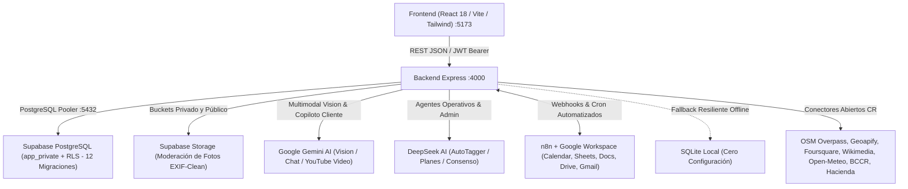

# 🐾 GoToX — Sistema Operativo Pet-Friendly y Copiloto Urbano para la GAM (Costa Rica)

**GoToX** es una plataforma fullstack inteligente diseñada para tutores de mascotas, comercios aliados y administración urbana en la **Gran Área Metropolitana (GAM) de Costa Rica** (San José, Heredia, Alajuela y Cartago).

Integra un backend empresarial en **Node.js + Express**, persistencia en **Supabase PostgreSQL** (`app_private` con RLS y **12 migraciones versionadas**) con respaldo automático en **SQLite**, **Supabase Storage** (buckets privado y público para moderación de fotografías), inteligencia artificial dual (**Google Gemini Multimodal Vision** para clientes y **DeepSeek AI** para operaciones/administración), **8 Agentes de IA con gobernanza y auditoría**, y **3 flujos de automatización en n8n conectados con Google Workspace**.

---

## 🏛️ Arquitectura del Sistema



### Estructura en Capas del Backend (`backend/src/`)
- `backend/src/config/` — Configuración de entorno, base de datos, Supabase, Google Gemini y DeepSeek.
- `backend/src/models/` — Modelos y acceso a entidades relacionales en 3FN (`users`, `roles`, `user_roles`, `user_consents`, `password_reset_tokens`, `data_deletion_requests`, `ai_interaction_logs`, `places`, `place_photos`).
- `backend/src/controllers/` — Controladores HTTP (`pet-vision-controller.js`, `agents-controller.js`, `auth-controller.js`, etc.).
- `backend/src/routes/` — Definición de rutas con guardias RBAC y rate limiting (`pet-vision-routes.js`, `agents-routes.js`, etc.).
- `backend/src/services/` — Lógica de negocio (`pet-vision-triage-service.js`, `ai-agents-hub-service.js`, etc.).
- `backend/src/middlewares/` — Validación de esquemas (`input-validator.js`), sanitización anti-Prototype Pollution/Prompt Injection/SSRF (`payload-sanitizer.js`), guardias JWT/RBAC (`auth-role-guard.js`) y cabeceras HTTP (`security-headers.js`).

---

## ✨ Módulos Principales

### 1. 🩺 Pre-Triaje Visual de Mascotas con Google Gemini Vision (`/api/pets/analyze-photo`)
Analizador multimodal que evalúa **de 1 a 3 fotografías simultáneas** de la mascota junto con síntomas reportados por el tutor:
- **Privacidad por Diseño (Ley N.º 8968):** Inspecciona el binario (`JPEG`, `PNG`, `WebP`) y **elimina automáticamente los metadatos EXIF/GPS (`APP1`/`XMP`)** antes de enviar la imagen a la nube de IA.
- **10 Áreas Clínicas Especializadas (`GET /api/pets/analyze-photo/focus-areas`):**
  `general`, `patas_almohadillas`, `piel_pelaje`, `ojos_orejas`, `dientes_encias`, `heridas_sangrado`, `garrapatas_parasitos`, `peso_condicion`, `postura_movilidad`, `golpe_calor_respiracion`.
- **Perfil Morfológico Aproximado (`approximate_profile`):** Especie, raza/cruce estimado, rango de peso en kg, etapa de edad, color de manto, condición corporal y sensibilidad térmica/braquicefalia.
- **Semáforo de Gravedad y Escalado Veterinario (`visual_health_triage` & `veterinary_action_plan`):**
  - Clasifica en `leve` (🟢), `moderado` (🟡) o `urgente` (🔴) con `severity_score` (1–10).
  - Cuando detecta un problema moderado o grande (quemaduras podales por asfalto, heridas abiertas, sangrado, infecciones oculares/óticas o golpe de calor), activa **`requires_vet_visit: true`** y **`immediate_emergency: true`**, entregando instrucciones de estabilización pre-traslado (`pre_transport_stabilization`), qué **NO** hacer en casa (`what_not_to_do`), 3 preguntas clave para el veterinario (`questions_for_your_vet`) y lista de signos vitales (`vital_signs_checklist`).
- **Clima Térmico GAM en Vivo + Clínicas Veterinarias 24/7 con GPS (`recommended_vet_clinics`):**
  - Calcula la temperatura estimada del asfalto (`estimated_asphalt_temp_c`) en tiempo real y ordena los hospitales veterinarios 24/7 de la GAM por especialidad y distancia GPS (`distance_km`), incluyendo enlaces directos a **Waze**, **Google Maps** y llamada telefónica (`tel:+506...`).
- **Seguimiento Evolutivo (`POST /api/pets/analyze-photo/follow-up`):** Compara una nueva foto contra un `previous_analysis_id` para determinar si la lesión va `mejorando`, `estable` o `empeorando`.

### 2. 🤖 Hub de 8 Agentes de IA con Gobernanza (`/api/agents`)
Todos los agentes aplican control de acceso por rol (RBAC), redactan datos personales (PII: correos, teléfonos de CR y cédulas) + escudo Anti-Prompt Injection antes de construir el prompt, y registran cada ejecución en la tabla `ai_interaction_logs`:
1. **`bruno-concierge`** *(Google Gemini)* — Copiloto de bienestar animal y rutas pet-friendly en la GAM.
2. **`video-analyzer`** *(Google Gemini)* — Analizador multimodal de videos educativos de YouTube con fragmentos verificados y marcas de tiempo (`startSeconds`).
3. **`auto-tagger`** *(DeepSeek AI)* — Clasificador semántico de comercios, acústica y terrazas.
4. **`propose-alternative`** *(DeepSeek AI)* — Replanificador automático de salidas ante lluvia o aforo alto.
5. **`daily-briefing`** *(DeepSeek AI)* — Editor del boletín operativo y térmico diario de la GAM.
6. **`lost-pet-matcher`** *(DeepSeek AI)* — Matcher visual y geográfico (Haversine) para alertas SOS de mascotas extraviadas.
7. **`invoice-extractor`** *(DeepSeek AI)* — Extractor de facturas con IVA (13%), servicio (10%) y división por SINPE Móvil.
8. **`report-consensus`** *(DeepSeek AI)* — Moderador de consenso para reportes ciudadanos.

### 3. 🗺️ Mapa Multi-Fuente Pet-Friendly y Moderación de Fotos en Supabase Storage
- **Coordinador Multi-Fuente (`GET /api/places/multisource/search`):** Combina catálogo interno verificado, OpenStreetMap (Overpass), Geoapify, Foursquare y Wikimedia Commons con caché y deduplicación geográfica.
- **Pipeline Seguro de Fotografías (`/api/admin/places/photos/*`):**
  - Subida desde el navegador en Base64 (`POST /api/admin/places/photos/upload`), validación de magic bytes y dimensiones mínimas, limpieza de EXIF y almacenamiento inicial en el bucket privado (`place-photos-private`) en estado `pending_review`.
  - Aprobación administrativa (`POST /api/admin/places/photos/:photoId/approve`) que promueve la imagen al bucket público (`place-photos-public`).
- **Políticas de Mascotas Verificadas:** Editor visual administrativo de políticas por comercio (`petPolicy`: tamaños permitidos, agua disponible, terraza techada, nivel acústico en dB y fecha de vigencia).

### 4. 🔐 Seguridad Empresarial y Cumplimiento Ley N.º 8968 (Costa Rica)
- **Autenticación y Sesiones:** Hashing con **`bcryptjs`** (`$2a$`/`$2b$`, factor 10) con migración automática de hashes legacy, rotación de Refresh Tokens y **revocación instantánea de Access Tokens JWT (`jti`)** al hacer `logout`, `reset-password` o `delete-account`.
- **Modelo Relacional 3FN:** Tablas `roles` y `user_roles`, registro inmutable de consentimiento informado en `user_consents` (`acceptTerms` y `acceptPrivacy` obligatorios), recuperación de contraseña (`password_reset_tokens` con vigencia de 15 minutos) y derecho al olvido (`POST /api/auth/delete-account` con auditoría en `data_deletion_requests`).
- **Blindaje HTTP y Payloads:**
  - Bloqueo **Anti-SSRF** (`assertSafeOutboundUrl`) contra `localhost`, IPs privadas RFC1918 y metadatos cloud (`169.254.169.254`) en `photo_url` y webhooks.
  - Middleware global **Anti-Prototype Pollution** (`__proto__`, `constructor`, `prototype`) y limpieza de bytes nulos.
  - Escudo **Anti-Prompt Injection** en todos los puntos de entrada de IA.
  - Rate Limiting por IP (protegido contra falsificación de `X-Forwarded-For`) y por cuenta de correo (`loginEmailLimiter`).

### 5. ⚡ Automatización con n8n + Google Workspace (`n8n/workflows/`)
Tres flujos listos para importar en **n8n**, estructurados como **un solo grafo 100% conectado** con nodos oficiales de Google:
1. [`01-pet-policy-expiring-alert.json`](n8n/workflows/01-pet-policy-expiring-alert.json) — Auditoría diaria de políticas pet-friendly por vencer + **Google Calendar** + **Google Gemini (`Basic LLM Chain`)** + **Gmail** + **Google Sheets**.
2. [`02-gam-daily-briefing-and-weather-sync.json`](n8n/workflows/02-gam-daily-briefing-and-weather-sync.json) — Boletín climático y térmico podal de la GAM + **Google Gemini** + **Google Docs** + **Google Drive** + **Google Sheets** + **Gmail**.
3. [`03-ley8968-data-deletion-and-sos-monitor.json`](n8n/workflows/03-ley8968-data-deletion-and-sos-monitor.json) — Gobernanza Ley N.º 8968 y monitor de emergencias SOS + **Google Sheets** + **Google Gemini** + **Google Calendar** + **Gmail**.

---

## 🚀 Inicio Rápido Local

### 1. Iniciar Backend y Frontend juntos (Recomendado)
Desde la raíz del repositorio:
```bash
npm run dev
```
Esto levanta simultáneamente:
- **Backend API:** `http://localhost:4000/api` (Documentación interactiva OpenAPI en `http://localhost:4000/api/docs`)
- **Frontend Vite:** `http://localhost:5173`

### 2. Comandos Útiles del Backend
```bash
cd backend

# Ejecutar migraciones en la base de datos local / configurada
npm run migrate

# Verificar estado y aplicar las 12 migraciones en Supabase Cloud
npm run db:supabase:check
npm run db:supabase:migrate

# Ejecutar la suite completa de pruebas automatizadas (137 pruebas)
npm test
```

---

## 🧪 Suite de Pruebas Automatizadas (137/137 Passing)

El backend incluye **137 pruebas automatizadas** con el runner nativo `node --test`:
- `backend/test/pet-vision-triage.test.js` — Pre-triaje visual con Google Gemini Vision, sanitización EXIF GPS, 10 áreas clínicas, derivación urgente a veterinarias 24/7 con rutas Waze/Maps y seguimiento evolutivo (`/follow-up`).
- `backend/test/rubric-100-compliance.test.js` — Validación de esquemas, registro con `acceptTerms`/`acceptPrivacy`, `bcryptjs`, 3FN (`user_roles`, `user_consents`), ciclo `forgot-password` → `reset-password` → `delete-account` (Ley N.º 8968) y ejecución de los 8 agentes de IA con anonimización PII en `ai_interaction_logs`.
- `backend/test/security-hardening.test.js` — RBAC en rutas administrativas, bloqueo Anti-SSRF, Anti-Prompt Injection, Anti-Prototype Pollution, revocación inmediata de JWT tras `logout`, protección de `X-Forwarded-For` y cabeceras de seguridad.
- `backend/test/photo-storage-pipeline.test.js` — Sanitización EXIF APP1, validación binaria, subida privada y aprobación pública en Supabase Storage.
- `backend/test/multisource-places.test.js` & `backend/test/pet-friendly-restaurants.test.js` — Búsqueda radial multi-fuente y filtros de políticas de mascotas.
- `backend/test/pet-care-videos.test.js` — Catálogo de videos educativos de YouTube, rotación en vivo y función «Pregúntale al video».
- `backend/test/enterprise-features.test.js` & `backend/test/full-backend-flow.test.js` — Transacciones ACID, Hash Chain Ledger, patrón Outbox, códigos QR criptográficos, BCCR/SINPE Móvil e i18n en 10 idiomas.
