# 05 — Diagrama Entidad-Relación (DER) y Diccionario de Datos (3FN)

Este documento describe el modelo relacional normalizado en **Tercera Forma Normal (3FN)** implementado en **Supabase PostgreSQL (`app_private`)** y replicado en **SQLite** para pruebas automatizadas (migraciones `001` a `012`).

---

## 1. Diagrama Entidad-Relación (Mermaid `erDiagram`)

```mermaid
erDiagram
    USERS ||--o{ USER_ROLES : "tiene (N:M)"
    ROLES ||--o{ USER_ROLES : "asignado_a (N:M)"
    USERS ||--o{ USER_CONSENTS : "acepta (1:N)"
    USERS ||--o{ PASSWORD_RESET_TOKENS : "solicita (1:N)"
    USERS ||--o{ REFRESH_TOKENS : "mantiene (1:N)"
    USERS ||--o| USER_VAULTS : "posee (1:1)"
    USERS ||--o{ DATA_DELETION_REQUESTS : "tramita (1:N)"
    USERS ||--o{ PLANS : "organiza (1:N)"
    USERS ||--o{ AI_INTERACTION_LOGS : "invoca (1:N)"

    PLACES ||--o{ PLACE_PET_EVIDENCE : "respalda (1:N)"
    PLACES ||--o{ PLACE_EXTERNAL_LINKS : "vincula (1:N)"
    PLACES ||--o{ PLACE_PHOTOS : "ilustra (1:N)"
    PLACES ||--o{ AUTOMATION_EVENTS : "genera (1:N)"

    PET_VIDEOS ||--o{ PET_VIDEO_FRAGMENTS : "contiene (1:N)"
    PET_VIDEOS ||--o{ PET_VIDEO_BROKEN_REPORTS : "recibe (1:N)"

    USERS {
        varchar id PK
        varchar name
        varchar email UK
        varchar password_hash
        varchar role
        integer gps_trust_score
        timestamp created_at
    }
    ROLES {
        varchar id PK
        varchar name UK
        text description
        timestamp created_at
    }
    USER_ROLES {
        varchar user_id PK,FK
        varchar role_id PK,FK
        timestamp assigned_at
    }
    USER_CONSENTS {
        varchar id PK
        varchar user_id FK
        varchar terms_version
        boolean privacy_accepted
        text cookies_preferences_json
        varchar ip_address
        timestamp accepted_at
    }
    PASSWORD_RESET_TOKENS {
        varchar id PK
        varchar user_id FK
        varchar token_hash
        timestamp expires_at
        timestamp used_at
    }
    DATA_DELETION_REQUESTS {
        varchar id PK
        varchar user_id
        varchar email
        text reason
        varchar status
        timestamp requested_at
        timestamp processed_at
    }
    USER_VAULTS {
        varchar user_id PK
        text pets_json
        integer vehicle_plate_digit
        text saved_routes_json
        numeric expenses_total_crc
        text badges_json
    }
    PLACES {
        varchar id PK
        varchar name
        varchar category
        text address
        numeric lat
        numeric lng
        boolean verified_by_admin
        text attributes_metadata
    }
    PLACE_PET_EVIDENCE {
        varchar id PK
        varchar place_id FK
        varchar source_type
        varchar access_status
        text conditions_json
        timestamp expires_at
    }
    PLACE_EXTERNAL_LINKS {
        varchar id PK
        varchar place_id FK
        varchar provider
        varchar external_id
        varchar match_status
    }
    PLACE_PHOTOS {
        varchar id PK
        varchar place_id FK
        varchar provider
        text photo_url
        varchar author
        varchar license
        varchar approval_status
        varchar content_hash
        varchar storage_bucket
    }
    AI_INTERACTION_LOGS {
        varchar id PK
        varchar agent_name
        varchar invoked_by
        varchar invoked_role
        text input_summary
        text output_summary
        varchar provider
        varchar model
        integer latency_ms
        varchar status
        timestamp created_at
    }
```

---

## 2. Diccionario de Datos (Entidades Clave)

### Seguridad y Gobernanza (Ley N.º 8968 CR)

| Tabla | Campo | Tipo de Dato | Restricciones | Propósito |
| :--- | :--- | :--- | :--- | :--- |
| `users` | `id` | `VARCHAR(64)` | `PRIMARY KEY` | Identificador único del usuario. |
| `users` | `email` | `VARCHAR(255)` | `NOT NULL, UNIQUE` | Correo normalizado en minúsculas (anonimizado al eliminar cuenta). |
| `users` | `password_hash` | `VARCHAR(255)` | `NOT NULL` | Hash seguro generado con `bcryptjs` (cost 10). |
| `users` | `role` | `VARCHAR(32)` | `CHECK (role IN (...))` | Rol principal compatible con JWT y RBAC. |
| `roles` | `id` / `name` | `VARCHAR(64)` | `PK` / `UNIQUE NOT NULL` | Catálogo normalizado de roles (`admin`, `organizer`, `merchant`, `business_owner`, `client`, `guest`). |
| `user_roles` | `user_id`, `role_id` | `VARCHAR(64)` | `PK (user_id, role_id), FK` | Tabla puente N:M entre `users` y `roles` con `ON DELETE CASCADE`. |
| `user_consents` | `id`, `user_id` | `VARCHAR(64)` | `PK`, `FK -> users(id)` | Registro auditable de aceptación de Términos y Política de Privacidad. |
| `user_consents` | `terms_version` | `VARCHAR(64)` | `NOT NULL` | Versión exacta de Términos aceptada (`2026-11-v2`). |
| `user_consents` | `privacy_accepted` | `BOOLEAN` | `NOT NULL DEFAULT TRUE` | Confirmación explícita de política de privacidad (Ley 8968). |
| `password_reset_tokens` | `id`, `user_id`, `token_hash` | `VARCHAR(64..128)` | `PK`, `FK`, `NOT NULL` | Token temporal (15 min) almacenado como hash SHA-256; se marca `used_at` al consumirse. |
| `data_deletion_requests` | `id`, `user_id`, `status` | `VARCHAR(32..64)` | `PK`, `NOT NULL` | Bitácora legal de bajas de cuenta y resumen de registros anonimizados retenidos. |
| `refresh_tokens` | `id`, `user_id`, `token_hash`, `revoked` | `VARCHAR`, `BOOLEAN` | `PK`, `FK`, `NOT NULL` | Rotación segura y revocación inmediata de sesiones. |

### Catálogo Multi-Fuente, Evidencia Pet-Friendly y Storage

| Tabla | Campo | Tipo de Dato | Restricciones | Propósito |
| :--- | :--- | :--- | :--- | :--- |
| `places` | `id`, `name`, `lat`, `lng` | `VARCHAR`, `NUMERIC` | `PK`, `CHECK lat/lng` | Establecimientos geolocalizados con metadatos estructurados. |
| `place_pet_evidence` | `id`, `place_id`, `access_status`, `expires_at` | `VARCHAR`, `TIMESTAMP` | `PK`, `CHECK access_status` | Evidencia verificable de políticas pet-friendly con vigencia semestral (180 días). |
| `place_external_links` | `id`, `place_id`, `provider`, `external_id` | `VARCHAR` | `PK`, `UNIQUE(provider, external_id)` | Enlace determinista por sucursal para evitar fusiones erróneas por nombre. |
| `place_photos` | `id`, `place_id`, `approval_status`, `content_hash`, `storage_bucket` | `VARCHAR` | `PK`, `CHECK status`, `UNIQUE(place_id, content_hash)` | Control de fotografías entre bucket privado (`pending_review`) y público (`approved`), con limpieza EXIF. |
| `photo_import_batches` | `id`, `status`, `imported_count`, `failed_count` | `VARCHAR`, `INTEGER` | `PK` | Control de lotes de importación y reanudación con compensación Storage ↔ BD. |
| `automation_events` | `id`, `event_type`, `dedupe_key`, `status` | `VARCHAR` | `PK`, `UNIQUE(dedupe_key)` | Cola idempotente de eventos consumidos por workflows de n8n. |

### Bóveda de Usuario, Auditoría Inmutable y Bitácora de IA

| Tabla | Campo | Tipo de Dato | Restricciones | Propósito |
| :--- | :--- | :--- | :--- | :--- |
| `user_vaults` | `user_id`, `pets_json`, `vehicle_plate_digit`, `saved_routes_json` | `VARCHAR`, `TEXT`, `INTEGER` | `PK` | Persistencia en BD de mascotas, rutas y preferencias del tutor. |
| `ai_interaction_logs` | `id`, `agent_name`, `invoked_by`, `invoked_role`, `provider`, `model`, `latency_ms`, `status` | `VARCHAR`, `TEXT`, `INTEGER` | `PK`, `NOT NULL` | Bitácora obligatoria en BD de cada invocación a los 8 agentes de IA (con PII redactada). |
| `audit_trail` / `audit_chain_ledger` | `id`, `action`, `block_hash`, `previous_hash` | `VARCHAR(64)` | `PK`, Trigger `BEFORE UPDATE OR DELETE` | Auditoría inmutable protegida por triggers a nivel de motor PostgreSQL. |
| `schema_migrations` | `filename`, `applied_at` | `VARCHAR(160)`, `TIMESTAMP` | `PK` | Registro histórico de migraciones SQL aplicadas. |
